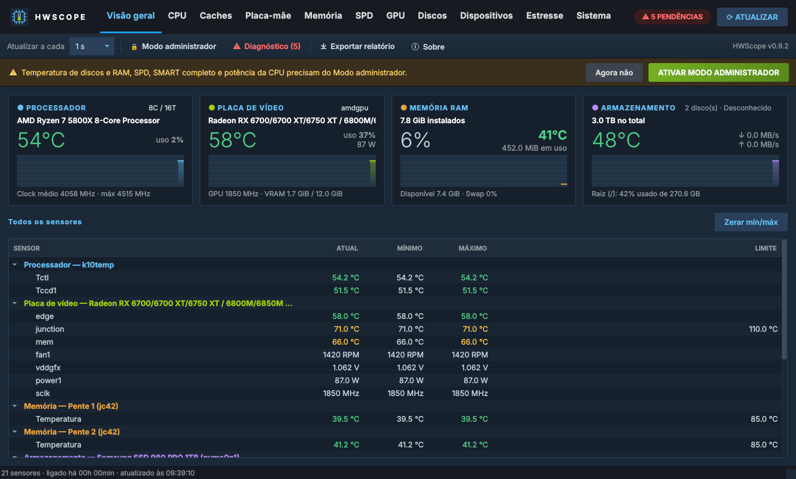
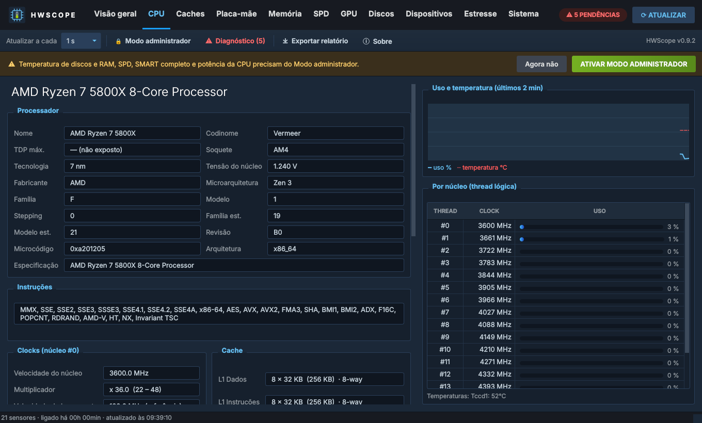
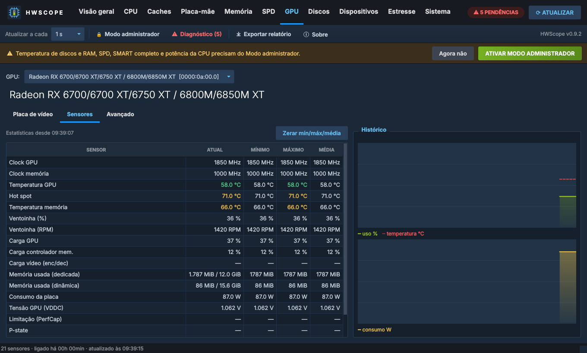

# HWScope — monitor de hardware para Linux

Temperaturas e uso em tempo real, mais informações detalhadas no estilo do CPU-Z, GPU-Z,
CrystalDiskInfo e HD Tune — num único AppImage.

| CPU | GPU |
|---|---|
|  |  |

## Baixar e usar

1. Baixe o `HWScope-x86_64.AppImage` na página de [Releases](../../releases).
2. Dê permissão de execução (botão direito → Propriedades → Permitir executar) ou:

       chmod +x HWScope-x86_64.AppImage
       ./HWScope-x86_64.AppImage

Requer x86_64 com glibc 2.28+ (Arch, Ubuntu 20.04+, Debian 10+, Fedora 29+, Mint 20+).
Se aparecer erro de FUSE, instale `fuse2` (Arch) / `libfuse2` (Ubuntu) ou rode com
`--appimage-extract-and-run`.

## O que ele mostra

- **Visão geral** — cartões de CPU, GPU, RAM e discos com gráfico dos últimos 2 min e todos os sensores (atual/mín/máx/limite).
- **CPU** — nome, codinome, soquete, tecnologia (nm), TDP, tensão do núcleo, família/modelo/stepping (e estendidos), revisão, instruções, multiplicador, cache, núcleos P/E, potência (RAPL), clocks e uso por thread.
- **Caches** — cada nível com tamanho, instâncias, associatividade, linha, conjuntos e compartilhamento.
- **Placa-mãe** — fabricante, modelo, chipset, ponte norte/sul, Super I/O, BIOS/UEFI e interface gráfica (PCIe).
- **Memória / SPD** — tipo, canais, frequência, timings e, por pente, fabricante, part number, série, data e tabela JEDEC/XMP/EXPO (DDR3, DDR4 e DDR5).
- **GPU** — codinome, processo, die, transistores, ROPs/TMUs, shaders, fillrates, TFLOPS, memória, Resizable BAR, OpenCL/CUDA/Vulkan/VA-API, e sensores com mín/máx/média.
- **Discos** — saúde Bom/Cuidado/Ruim com SMART completo e alerta de piora, verificação de superfície (somente leitura) e teste de velocidade SEQ/RND.
- **Dispositivos** — rede e Wi-Fi, bateria, ventoinhas (com nomes editáveis), USB e áudio.
- **Estresse** — carga de CPU/RAM com temperatura, clock, potência, detecção de queda de clock e parada automática.
- **Sistema** — distribuição, kernel, ambiente gráfico e swap (zram, zswap, swappiness).
- **Visual** — tema escuro azul com botões retangulares.

## Modo administrador

Um único botão no topo pede a senha uma vez e libera, até fechar o app: drivers de sensores
(disco SATA, RAM e placa-mãe — gravados em `/etc/modules-load.d/hwscope-sensors.conf`), SPD,
dmidecode, SMART completo, potência RAPL e verificação de superfície.
Um pequeno processo auxiliar roda como root, aceita só uma lista fixa de operações e fecha junto com o app.

## Dependências

O botão **Diagnóstico** verifica tudo e mostra o comando de instalação para a sua distro.

    # Arch
    sudo pacman -S --needed polkit kmod udisks2 smartmontools dmidecode mesa-utils vulkan-tools clinfo libva-utils iw libpulse lm_sensors
    # Ubuntu / Mint / Debian
    sudo apt install pkexec kmod udisks2 smartmontools dmidecode mesa-utils vulkan-tools clinfo vainfo iw pulseaudio-utils lm-sensors

## Estrutura do projeto

    main.py            ponto de entrada
    core/              coleta de dados, sem dependência de Qt
      hwinfo.py          CPU, sensores, GPU, discos, placa-mãe, swap, dependências
      spd.py             decodificação de SPD (DDR3/DDR4/DDR5, XMP/EXPO)
      health.py          saúde dos discos (SMART, UDisks2, histórico)
      devices.py         rede, bateria, ventoinhas, USB, áudio
      rootbroker.py      processo do Modo administrador
      cpudb.py gpudb.py  bases de codinomes de CPU e de chips de GPU
      surface.py diskbench.py stress.py   verificação de superfície, teste de velocidade, estresse
    ui/                interface (PySide6), uma aba por arquivo, tema em ui/theme.py
    data/              pci.ids, usb.ids e fabricantes JEDEC
    tests/             testes com um PC simulado (tests/fakesys.py)
    tools/             gerar capturas de tela, ícone e enxugar o PySide6
    packaging/         AppRun e atalho .desktop do AppImage

Para gerar o AppImage localmente: `./build.sh` (requer `squashfs-tools`).

## Licença

GPL-3.0. Inclui `pci.ids`/`usb.ids` (projeto linux-usb/pciids) e a tabela de fabricantes
JEDEC do `decode-dimms` (i2c-tools).

